# docextract

[](https://www.python.org/)
[](LICENSE)
[](https://github.com/astral-sh/ruff)
[](https://mypy-lang.org/)

A verified invoice and receipt extraction pipeline that pairs PDF/OCR layout parsing and bounding-box-grounded LLM extraction with deterministic financial math, tax, date, and ISO 13616 IBAN checksum rules, multi-signal field confidence scoring, and a side-by-side human review queue.

---

## Overview

Probabilistic LLM and VLM extractors frequently misread digits on dense tables or hallucinate totals that do not reconcile with line items. `docextract` adds a **deterministic verification and spatial grounding layer** around structured extraction so unverified numbers never silently enter downstream accounting or ERP systems:

1. **Magic-Byte Ingest & Page Splitting (`docextract.ingest`):** Sniffs raw file magic bytes (`%PDF-`, PNG, JPEG, WEBP, little/big-endian TIFF), enforces byte-size and page-count limits, deduplicates by SHA-256 content hash, and rasterizes multi-page documents to 300 DPI PNGs via `pypdfium2`.
2. **Hybrid Layout & Projection Deskew (`docextract.vision`):** Extracts native PDF character/word bounding boxes normalized to `[0.0, 1.0]` page coordinates. Scanned pages with no native text layer are automatically deskewed via coarse-to-fine horizontal projection variance maximization and routed through ONNX OCR (`rapidocr-onnxruntime`).
3. **Grounded Schema Extraction & Repair Loop (`docextract.extract`):** Prompts any LiteLLM-supported model (Gemini, OpenAI, Azure OpenAI, Ollama) with the target Pydantic JSON Schema (`Invoice` or `Receipt`), runs a self-healing validation-error repair loop on malformed outputs, and grounds extracted values back to their physical page `BoundingBox`.
4. **Deterministic Financial & Checksum Rule Engine (`docextract.validate`):** Executes pluggable verification rules using exact `Decimal` half-up rounding (`line_item_math`, `subtotal_math`, `tax_line_math`, `tax_total_math`, `tax_rate_plausibility`, `grand_total_math`, `invoice_due_date_order`, `date_range_sanity`, `iban_checksum` mod-97, `tax_id_format`, and cross-document `duplicate_vendor_invoice`).
5. **Multi-Signal Confidence Fusion & Human Review Queue (`docextract.scoring`, `docextract.ui`):** Fuses OCR token confidence, bbox grounding coverage, multi-sample LLM self-consistency agreement, and validation rule outcomes into per-field confidence scores. Documents that fail any rule or fall below `min_field_confidence` route to a Jinja2 + HTMX review UI (`/review`) with clickable SVG bounding-box overlays and an immutable SQLite/Postgres audit trail.

```mermaid
flowchart LR
    IN["PDF / PNG / JPG / TIFF upload"] --> ING["Ingest<br/>MIME sniff, page split, SHA-256 dedupe"]
    ING --> PRE["Preprocess<br/>projection deskew, adaptive threshold"]
    PRE --> LAY["Layout + OCR<br/>PDF text layer or ONNX OCR fallback<br/>words + normalized bboxes"]
    LAY --> EXT["Extraction<br/>LLM to Pydantic schema<br/>repair loop + bbox grounding"]
    EXT --> VAL["Validation engine<br/>Decimal math, dates, tax, IBAN mod-97"]
    VAL --> CONF["Confidence scoring<br/>OCR x grounding x consistency x rules"]
    CONF -->|"all checks pass"| DB[("SQLite / Postgres<br/>approved records")]
    CONF -->|"rule failure or low confidence"| RQ["Human review queue<br/>SVG bbox UI (/review)"]
    RQ -->|"audited field edits"| DB
    DB --> OUT["REST API, CSV/JSON export,<br/>HMAC-SHA256 webhooks"]
    EVAL["Eval harness + Fault injector"] --> EXT
```



---

## Tech Stack

| Layer | Technology | Purpose |
|---|---|---|
| Language | Python 3.11 | Strictly typed (`mypy --strict`), linted with `ruff` |
| Schemas & Math | Pydantic v2 + `Decimal` | Immutable `Invoice`, `Receipt`, `Money`, `BoundingBox`, `WordToken` |
| PDF & Raster | `pypdfium2` + Pillow | Native PDF text/charbox extraction, 300 DPI page rendering, projection deskew |
| OCR Fallback | `rapidocr-onnxruntime` | CPU-only ONNX OCR for scanned PDFs and raster images |
| LLM Client | LiteLLM | Provider-agnostic JSON extraction + `ScriptedLLM` test double |
| Persistence | SQLModel + SQLite / Postgres | Document state machine, persistent job queue, reviewer audit log |
| API & Review UI | FastAPI + Jinja2 + HTMX | Async REST endpoints, PNG/SVG bbox overlays, side-by-side review workspace |
| Synthetic Data | ReportLab + Faker | Multi-layout PDF generator (`corporate_table`, `modern_sidebar`, `thermal_receipt`) + fault injector |

---

## Quickstart

### 1. Install

```bash
git clone https://github.com/Exryz/docextract.git
cd docextract

python -m venv .venv
# Windows (PowerShell)
.venv\Scripts\Activate.ps1
# Linux / macOS
source .venv/bin/activate

pip install -e .[dev]
# Optional CPU ONNX OCR for image-only scans:
pip install -e .[ocr]
```

### 2. Configure `.env`

```bash
cp .env.example .env
```

Set your LLM provider and key in `.env`:

```ini
DOCEXTRACT_LLM_MODEL=gemini/gemini-3.5-flash
GEMINI_API_KEY=your_api_key_here
```

### 3. Generate Synthetic Invoices & Receipts (Optional)

Generate deterministic PDFs with gold JSON labels and controlled mathematical/scan faults:

```bash
docextract-datagen --count 12 --out-dir .data/synthetic --seed 100
```

### 4. Run the API & Human Review Queue UI

```bash
uvicorn docextract.api.main:app_factory --factory --host 0.0.0.0 --port 8000 --reload
```

- **Human Review Queue UI:** `http://localhost:8000/review`
- **Interactive OpenAPI Docs:** `http://localhost:8000/docs`
- **CSV / JSON Exports:** `http://localhost:8000/export.csv?status=approved` & `http://localhost:8000/export.json`

Or run with Docker Compose:

```bash
docker compose up --build
```

---

## REST API & Webhook Reference

| Method & Path | Description |
|---|---|
| `POST /documents` | Upload a PDF/PNG/JPEG/WEBP/TIFF document (supports `Idempotency-Key` header and `run_sync=true/false`) |
| `GET /documents` | List documents filtered by `status` (`received`, `needs_review`, `approved`, `rejected`, `failed`) and `kind` |
| `GET /documents/{id}` | Retrieve extracted fields, validation rule report, per-field confidence scores, and reviewer audit trail |
| `GET /documents/{id}/pages/{n}.png` | Render page `n` as PNG with green (verified) and red (flagged) bounding-box overlays (`?overlay=true`) |
| `POST /documents/{id}/review` | Apply human field overrides (`total`, `vendor.name`, `line_items[0].amount`), re-validate, and approve/reject |
| `GET /jobs/{job_id}` | Inspect background extraction job status, attempt counter, and error details |
| `GET /export.csv` / `GET /export.json` | Export verified documents as RFC 4180 CSV or structured JSON |

**Outbound Webhooks:** When `DOCEXTRACT_WEBHOOK_URL` is configured, status transitions emit `document.approved`, `document.needs_review`, or `document.rejected` POST events signed with `X-Docextract-Signature: sha256=<hmac>` and `X-Docextract-Timestamp` (verified via constant-time `hmac.compare_digest` with exponential backoff retries).

### API Usage Examples

```bash
# 1. Upload and extract an invoice (idempotent)
curl -X POST http://localhost:8000/documents \
  -H "Idempotency-Key: inv-2026-0042" \
  -F "file=@invoice.pdf"

# 2. Inspect extracted fields, validation rules, and confidence scores
curl http://localhost:8000/documents/<document_id>

# 3. Apply a human correction and approve
curl -X POST http://localhost:8000/documents/<document_id>/review \
  -H "Content-Type: application/json" \
  -d '{"reviewer":"ops.lead","action":"approved","field_overrides":{"total":"672.00"}}'

# 4. Export verified documents to CSV
curl "http://localhost:8000/export.csv?status=approved" -o verified_invoices.csv
```

---

## Evaluation Benchmark (`evals/run_evals.py`)

Evaluated across 24 synthetic documents spanning all 3 layout templates (`corporate_table`, `modern_sidebar`, `thermal_receipt`) and 6 fault categories (`wrong_line_amount`, `wrong_subtotal`, `wrong_tax`, `wrong_total`, `inverted_dates`, `rotated_scan`):

| Layout Template | Samples | Field Micro F1 | Grand Total Exact-Match | Bbox Grounding Coverage | Fault-Injection Catch Rate |
|---|---|---|---|---|---|
| `corporate_table` | 8 | 100.0% | 100.0% | 99.1% | 100.0% |
| `modern_sidebar` | 8 | 100.0% | 100.0% | 99.2% | 100.0% |
| `thermal_receipt` | 8 | 100.0% | 100.0% | 98.9% | 100.0% |
| **Overall (24 docs)** | **24** | **100.0%** | **100.0%** | **99.1%** | **100.0%** |

Re-run the evaluation suite locally:

```bash
# Fast offline deterministic benchmark (used in CI)
python -m evals.run_evals --count 24 --seed 1000 --offline

# Live LLM benchmark with resumable JSONL cache across rate-limit windows
python -m evals.run_evals --count 24 --seed 1000 --resume evals/results/live_cache.jsonl
```

---

## Project Layout

```text
docextract/
├── .github/workflows/ci.yml   # Ruff, mypy --strict, pytest, offline eval smoke test, Docker build
├── Dockerfile                 # Python 3.11 container image for FastAPI + Review UI
├── docker-compose.yml         # Persistent volume deployment stack
├── pyproject.toml             # Package metadata and strict mypy/ruff/pytest configuration
├── datagen/                   # Multi-layout synthetic PDF generator and fault injector CLI
├── evals/                     # Field-level P/R/F1, grounding, and fault-catch evaluation runner
│   └── results/latest.md      # Latest benchmark summary table
├── src/docextract/
│   ├── config.py              # Environment / .env settings (DOCEXTRACT_ prefix)
│   ├── schemas/               # Money (Decimal), BoundingBox, WordToken, Invoice, Receipt
│   ├── ingest/                # Magic-byte MIME sniffer, SHA-256 dedupe, pypdfium2 page splitter
│   ├── vision/                # PDF text/charbox extractor, projection deskew, RapidOCR fallback
│   ├── extract/               # LiteLLM client, schema-constrained prompts, repair loop, grounding
│   ├── validate/              # Pluggable rule registry, Decimal math rules, IBAN/tax checksums
│   ├── scoring/               # Multi-signal field confidence fusion and review routing
│   ├── store/                 # SQLModel repository, document state machine, reviewer audit log
│   ├── jobs/                  # Persistent background job queue with idempotency keys and retries
│   ├── api/                   # FastAPI application, bbox overlay renderer, CSV/JSON export, webhooks
│   └── ui/                    # Jinja2 + HTMX review queue and interactive SVG bbox detail view
└── tests/                     # 46 offline unit and integration tests
```

---

## Development & Verification

```bash
pytest -q
ruff check .
mypy
```

---

## License

[MIT](LICENSE) © 2026 Exryz
