# docextract

[](https://www.python.org/)
[](LICENSE)
[](https://github.com/astral-sh/ruff)
[](https://mypy-lang.org/)

A verified invoice and receipt extraction pipeline that combines PDF/OCR layout parsing, bounding-box-grounded LLM extraction, deterministic arithmetic/tax/checksum validation rules, field-level confidence scoring, and a human-in-the-loop review queue.

---

## Architecture

```mermaid
flowchart LR
    IN["PDF / PNG / JPG upload"] --> ING["Ingest<br/>MIME sniff, page split, SHA-256 dedupe"]
    ING --> PRE["Preprocess<br/>deskew, denoise, 300 DPI"]
    PRE --> LAY["Layout + OCR<br/>PDF text layer or OCR fallback<br/>words + bounding boxes"]
    LAY --> EXT["Extraction<br/>VLM/LLM to Pydantic schema<br/>with bbox grounding"]
    EXT --> VAL["Validation engine<br/>math, dates, tax, checksums"]
    VAL --> CONF["Confidence scoring<br/>OCR x LLM x rule agreement"]
    CONF -->|"all checks pass"| DB[("SQLite / Postgres<br/>verified records")]
    CONF -->|"fails or low confidence"| RQ["Human review queue<br/>side-by-side UI"]
    RQ -->|"corrections"| DB
    DB --> OUT["REST API, CSV/JSON export,<br/>HMAC webhooks"]
```



---

## Quickstart

```bash
python -m venv .venv
.venv\Scripts\Activate.ps1
pip install -e .[dev]

pytest -q
ruff check .
mypy
```

## License

[MIT](LICENSE) © 2026 Paul Andrei Datinguinoo
